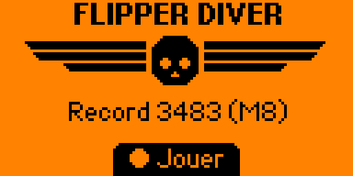
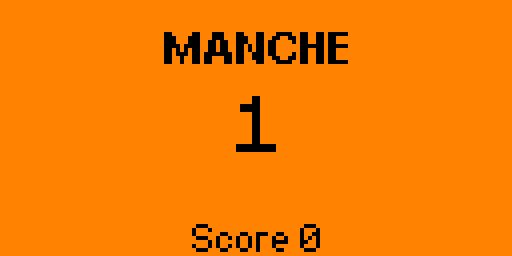
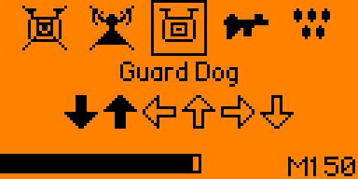
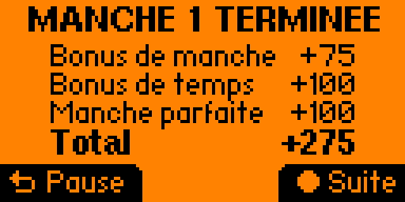
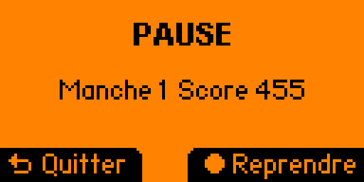
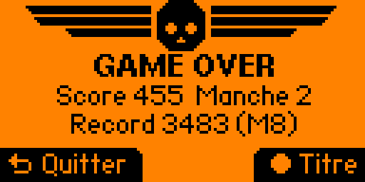
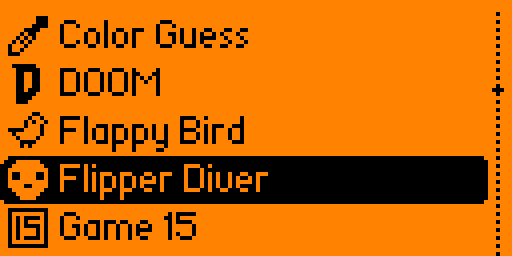

# 💀 Flipper Diver

[](https://github.com/Safenein/flipper-diver/actions/workflows/ci.yml)
[](https://github.com/Safenein/flipper-diver/releases/latest)
[](https://github.com/Safenein/flipper-diver/releases/tag/nightly)
[](LICENSE)

Le mini-jeu des stratagèmes de Helldivers 2 (« Stratagem Hero ») sur Flipper Zero :
recopie au pavé directionnel la séquence de flèches de chaque stratagème avant la
fin du chrono, pour la Super-Terre. 🫡

| | | |
|:-:|:-:|:-:|
|  |  |  |
| Titre | Annonce | Manche |
|  |  |  |
| Fin de manche | Pause | Game over |

## 🎮 Le jeu

- Chaque manche enchaîne des stratagèmes (6 + n pour la manche n, 16 au plus),
  parmi 20 vrais stratagèmes du jeu.
- Le chrono démarre à 10 s ; chaque stratagème réussi rend 1,5 s (10 s au plus).
  À zéro, c'est le game over.
- Une mauvaise flèche fait vibrer le Flipper et recommence la séquence en cours.
- Points : 5 par flèche, puis en fin de manche un bonus de manche, un bonus de
  temps restant et un bonus de manche parfaite (sans erreur).
- Le record est gardé sur la carte SD.

| Touche | Action |
|--------|--------|
| ⬆️ ⬇️ ⬅️ ➡️ | saisir les flèches |
| OK | jouer, reprendre, passer la fin de manche |
| Back | pause ; quitter depuis le titre, la pause ou le game over |

## 📥 Installation

1. Télécharger [`flipper_diver.fap`](https://github.com/Safenein/flipper-diver/releases/latest/download/flipper_diver.fap)
   depuis la [dernière release](https://github.com/Safenein/flipper-diver/releases/latest).
2. Le copier dans `apps/Games/` sur la carte SD, avec [qFlipper](https://flipperzero.one/update)
   ou l'app mobile.
3. Lancer **Apps → Games → Flipper Diver**.

   

Cible : firmware officiel, canal release ; le numéro d'API du SDK utilisé est dans
les notes de chaque release. Une app compilée pour une autre version majeure de
l'API refuse de se lancer : prendre alors la release qui correspond, ou la
recompiler. L'app tourne aussi sur Momentum.

🌙 La pré-release [`nightly`](https://github.com/Safenein/flipper-diver/releases/tag/nightly)
est reconstruite chaque nuit depuis `master` quand il a bougé. Elle n'est pas
vérifiée sur l'appareil.

## 🛠️ Développement

Avec [devenv](https://devenv.sh) (et direnv, ou `devenv shell`) :

| Commande | Rôle |
|----------|------|
| `build` | compile avec ufbt vers `dist/flipper_diver.fap` |
| `launch` | installe et lance l'app sur un Flipper branché en USB |
| `unit-tests` | tests de la logique de jeu sur PC, avec ASan et UBSan |
| `fmt` | clang-format sur les sources C |
| `changelog` | régénère `CHANGELOG.md` avec git-cliff |
| `screenshots` | joue une manche sur le Flipper branché (app sur son titre) et capture chaque écran dans `docs/screenshots/` |
| `devenv test` | tests, build et vérification du formatage, comme la CI |

Sans devenv : `pip install -r requirements.txt`, puis `ufbt`, `ufbt launch` et
`bash tools/unit-tests.sh`.

Sous Linux, l'accès au port série du Flipper (`/dev/ttyACM0`) demande d'être dans
le groupe `dialout`, ou les règles udev du Flipper (`hardware.flipperzero.enable`
sous NixOS).

Les captures passent par le protocole RPC du Flipper, celui qu'utilise qFlipper
pour diffuser l'écran ([`tools/flipper_rpc.py`](tools/flipper_rpc.py)) :
[`tools/screenshots.py`](tools/screenshots.py) lit les flèches à l'écran et les
tape pour jouer la manche.

Les icônes sont dessinées en ASCII art dans [`tools/make_icons.py`](tools/make_icons.py) :
modifier le script, puis `python tools/make_icons.py images`.

La spec technique est dans [`docs/spec/`](docs/spec/README.md), et celle des
règles du jeu dans [`specs/001-regles-du-jeu/`](specs/001-regles-du-jeu/).

## 🔄 CI et releases

| Workflow | Déclencheur | Ce qu'il fait |
|----------|-------------|---------------|
| [CI](.github/workflows/ci.yml) | push sur `master`, pull request | tests sur PC, formatage, build du FAP (artefact) |
| [Nightly](.github/workflows/nightly.yml) | chaque nuit à 03:17 UTC, ou à la main | si `master` a bougé : pré-release `nightly` avec les changements non publiés |
| [Release](.github/workflows/release.yml) | push d'un tag `vX.Y` | vérifie le tag, construit et publie la release avec ses notes |

Les trois partagent [`build.yml`](.github/workflows/build.yml), qui compile avec
le SDK du dernier firmware officiel du canal release. Les actions sont épinglées
par SHA, et Dependabot propose leurs mises à jour.

### 📝 Changelog

[`CHANGELOG.md`](CHANGELOG.md) et les notes de release sont générés par
[git-cliff](https://git-cliff.org) ([`cliff.toml`](cliff.toml)) à partir des
messages de commit, au format [Conventional Commits](https://www.conventionalcommits.org/fr/) :
`feat` → ✨ Nouveautés, `fix` → 🐛 Corrections, `docs` → 📝 Documentation, etc.
Seuls les tags `vX.Y` délimitent des versions ; le tag `nightly` est ignoré.

### 🚀 Publier une version

Les commits et les tags sont signés avec GPG : GitHub les affiche « Verified »
tant que la clé publique est sur le compte.

```sh
# 1. Passer fap_version à "0.2" dans application.fam (deux nombres : X.Y).
# 2. Mettre le changelog à jour, avec les commits non publiés sous v0.2 :
changelog --tag v0.2
# 3. Committer et pousser :
jj commit -m "chore(release): v0.2"
jj bookmark set master -r @-
jj git push --bookmark master
# 4. Tag annoté et signé sur ce commit, puis le pousser (jj ne pousse pas les tags) :
git tag -s v0.2 -m "Flipper Diver v0.2" master
git push origin v0.2
```

Le workflow Release refuse un tag qui ne correspond pas à `fap_version`. Le
message du tag apparaît en tête des notes de release, sans la signature GPG.

## ⚖️ Licence

[GPL-3.0](LICENSE), comme le firmware du Flipper Zero.

Projet de fan, sans lien avec Arrowhead Game Studios ni Sony Interactive
Entertainment. Helldivers est une marque de Sony Interactive Entertainment.
