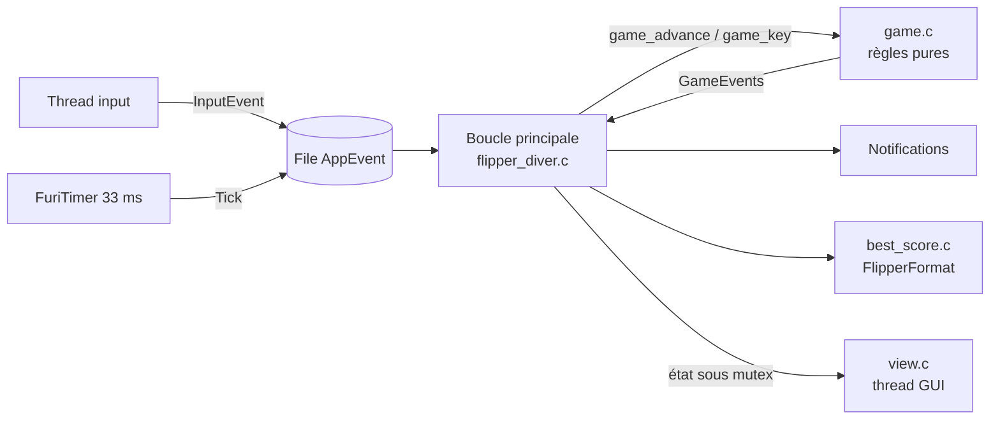
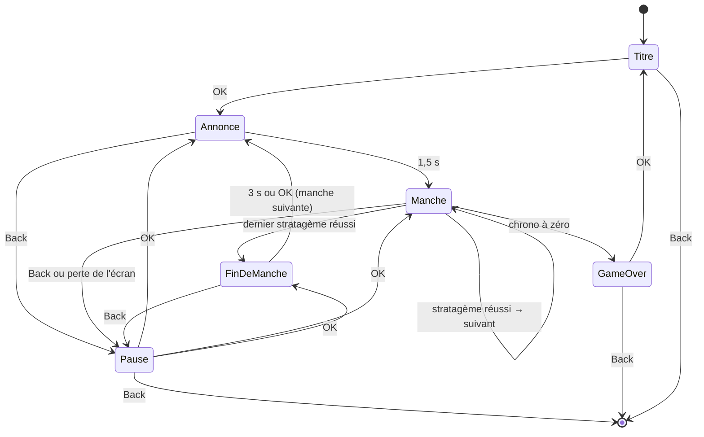

# Flipper Diver

## Contexte

Application externe (FAP) pour Flipper Zero qui reproduit le mini-jeu « Stratagem
Hero » de Helldivers 2 : un stratagème s'affiche avec sa séquence de flèches, le
joueur la recopie au pavé directionnel avant la fin du chrono et marque des points.

Elle tourne sur le firmware **officiel, canal release** (SDK 1.4.3, API 87.1 au
moment de l'écriture), en local sur l'appareil, sans réseau ni périphérique externe.
Les règles détaillées et leur origine sont dans `specs/001-regles-du-jeu/`.

## Objectifs / non-objectifs

- Objectif : jouer à Stratagem Hero au D-pad, avec chrono, score et enchaînement de
  manches.
- Objectif : app publiable sur le Flipper App Catalog (firmware officiel, pas d'API
  privée).
- Non-objectif : compatibilité garantie avec les firmwares custom (Momentum,
  Unleashed) — ils peuvent marcher, ils ne sont pas testés.
- Non-objectif : reprendre les visuels ou sons du jeu original (droits) ; les
  icônes de stratagèmes sont redessinées en 1 bit.
- Non-objectif : réglages dans l'app, tableau des scores, liste complète des
  stratagèmes du jeu (`specs/001-regles-du-jeu/requirements.md`).

## Glossaire

| Terme | Sens |
|-------|------|
| Stratagème | Entrée de la table de jeu : un nom, une icône, une séquence. |
| Séquence | Suite ordonnée de 3 à 8 flèches (↑ ↓ ← →) à saisir pour un stratagème. |
| Saisie | Appui sur une flèche pendant une manche, compté dès l'appui. |
| Manche | Série de min(6 + n, 16) stratagèmes à enchaîner avant la fin du chrono. |
| Chrono | Temps restant de la manche : 10 s au départ, +1,5 s par stratagème réussi, 10 s au plus. |
| Erreur | Saisie qui ne correspond pas à la flèche attendue : la séquence en cours repart du début. |
| Manche parfaite | Manche finie sans aucune erreur ; rapporte un bonus de 100. |
| Record | Meilleur score (et manche atteinte), conservé sur la carte SD. |

## Architecture



| Composant | Rôle | Dépend de Furi |
|-----------|------|----------------|
| `game.c`, `game.h` | Machine à états, chrono, barème, tirage des manches | non (ADR-0004) |
| `stratagems.c`, `stratagems.h` | Table des 20 stratagèmes | non |
| `view.c`, `view.h` | Rendu de chaque phase, table des icônes | oui |
| `best_score.c`, `best_score.h` | Lecture et écriture du record | oui |
| `flipper_diver.c` | Point d'entrée, file d'événements, timer, notifications, détection de perte d'écran | oui |
| `tools/make_icons.py` | Source ASCII des icônes `images/*.png` (stratagèmes, bannière, touches) | — |
| `tests/` | Tests unitaires sur PC (`unit-tests`), hors du FAP | non |

- **Callbacks d'entrée et de timer** (`flipper_diver.c:app_input_callback`,
  `app_timer_callback`) : poussent un `AppEvent` dans la file sans bloquer.
- **Boucle principale** (`flipper_diver.c:flipper_diver_app`) : seule à modifier
  l'état du jeu. Pour chaque événement : `game_advance` du temps écoulé, puis
  `game_key` si la touche compte, puis notifications, écriture éventuelle du record
  et rafraîchissement immédiat.
- **Rendu** (`flipper_diver.c:app_draw_callback` → `view.c:view_draw`) : thread GUI,
  lit l'état sous mutex et note l'heure du dernier dessin.
- **Règles** (`game.c`) : toutes les durées sont des restes en ms décrémentés par
  `game_advance`, uniquement dans les phases Annonce, Manche et Fin de manche ; la
  pause n'a donc rien à sauvegarder.

### Déroulé du jeu



## Interfaces

Touches : les flèches comptent à l'appui (`InputTypePress`), OK et Back à l'appui
court (`InputTypeShort`) ; tous les autres événements sont ignorés
(`flipper_diver.c:app_game_key`).

| Touche | Titre | Annonce | Manche | Fin de manche | Pause | Game over |
|--------|-------|---------|--------|---------------|-------|-----------|
| ↑ ↓ ← → | — | ignorées | saisie | — | — | — |
| OK | démarrer | — | — | manche suivante | reprendre | retour au titre |
| Back | quitter | pause | pause | pause | quitter (sans record) | quitter |

Fichier de record : `APP_DATA_PATH("best.fff")`, soit
`/ext/apps_data/flipper_diver/best.fff`, au format FlipperFormat :

```
Filetype: Flipper Diver Best Score
Version: 1
Score: 1520
Round: 3
```

Un fichier absent, illisible ou d'une autre version vaut un record de 0
(`best_score.c:best_score_load`).

Manifeste : `application.fam` (appid `flipper_diver`, catégorie `Games`,
`sources=["*.c", "!tests"]`, `fap_icon_assets="images"`).

Mesures : `FLIPPER_DIVER_METRICS` à 1 dans `flipper_diver.c` consigne à chaque fin
de manche l'écart maximal entre deux images, la latence maximale entre un appui et
son affichage, et le tas libre.

## Données

- Table des stratagèmes (`stratagems.c:stratagems`) : 20 entrées constantes en
  flash, nom (21 caractères au plus) et séquence en lettres `UDLR`. Les icônes sont
  dans un tableau parallèle de `view.c`, dans le même ordre.
- État du jeu (`game.h:Game`) : dans la structure de l'app, allouée au lancement
  et libérée à la sortie. Une manche est un tableau fixe de 16 indices.
- Record : chargé au lancement, écrit seulement quand il est battu.

## Invariants

| Invariant | Comment c'est garanti |
|-----------|----------------------|
| Les callbacks d'entrée et de timer ne bloquent jamais | `furi_message_queue_put` avec un délai de 0 ; relecture |
| Seule la boucle principale écrit l'état ; le rendu le lit sous le même mutex | relecture de `flipper_diver.c` |
| `game.c` et `stratagems.c` n'incluent rien de Furi | compilés sur PC par `unit-tests` à chaque `devenv test` |
| Toute allocation se fait au lancement, au chargement ou à l'écriture du record ; aucune pendant une manche ni dans le rendu | relecture ; mesure du tas avec `FLIPPER_DIVER_METRICS` — **à faire sur l'appareil** |
| Chaque stratagème a une icône | `_Static_assert` dans `view.c` (le build échoue sinon) |
| Séquences de 3 à 8 flèches valides, noms uniques de 21 caractères au plus | `tests/test_stratagems.c` |
| Aucun stratagème n'apparaît deux fois de suite, même d'une manche à l'autre | test de propriété sur 10 000 manches (`tests/test_game.c`) |
| Écran rafraîchi au moins à 25 Hz en manche, affichage d'un appui en 40 ms au plus | timer à 30 Hz et rafraîchissement immédiat après une saisie ; mesure — **à faire sur l'appareil** |
| Toute ressource allouée au lancement est libérée à la sortie, dans l'ordre inverse | relecture de `app_free` — **pas encore vérifié sur l'appareil** |
| Le build `ufbt` passe sans avertissement sur le SDK release | `devenv test` (ufbt compile en `-Werror`) |

## Décisions

| ADR | Titre | Statut |
|-----|-------|--------|
| [0001](adr/0001-firmware-officiel-ufbt-c.md) | Firmware officiel, ufbt et C | accepted |
| [0002](adr/0002-viewport-simple.md) | Un seul ViewPort plutôt qu'un ViewDispatcher | accepted |
| [0003](adr/0003-ufbt-dans-un-fhs-devenv.md) | ufbt dans un environnement FHS sous devenv | accepted |
| [0004](adr/0004-regles-pures-testees-sur-pc.md) | Règles du jeu dans un module pur, testé sur PC | accepted |

## Questions ouvertes

- Séquences des 20 stratagèmes, écrites de mémoire : à valider (safenein).
- Aucune vérification sur l'appareil n'a encore eu lieu : écrans, notifications,
  record, mesures, et l'hypothèse de la détection de perte d'écran (la GUI
  n'appellerait pas le callback d'un ViewPort masqué) (safenein).
- Valeurs du chrono et du barème à ajuster après des parties sur l'appareil
  (safenein).
