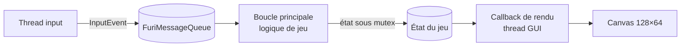
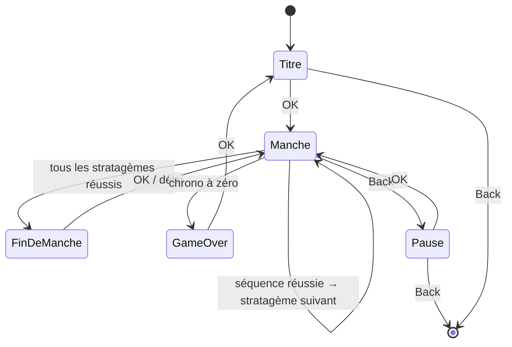

# Flipper Diver

## Contexte

Application externe (FAP) pour Flipper Zero qui reproduit le mini-jeu « Stratagem
Hero » de Helldivers 2 : un stratagème s'affiche avec sa séquence de flèches, le
joueur la recopie au pavé directionnel avant la fin du chrono et marque des points.

Elle tourne sur le firmware **officiel, canal release** (SDK 1.4.3, API 87.1 au
moment de l'écriture), en local sur l'appareil, sans réseau ni périphérique externe.

## Objectifs / non-objectifs

- Objectif : jouer à Stratagem Hero au D-pad, avec chrono, score et enchaînement de
  manches.
- Objectif : app publiable sur le Flipper App Catalog (firmware officiel, pas d'API
  privée).
- Non-objectif : compatibilité garantie avec les firmwares custom (Momentum,
  Unleashed) — ils peuvent marcher, ils ne sont pas testés.
- Non-objectif : reprendre les visuels ou sons du jeu original (droits) ; les
  icônes de stratagèmes sont redessinées en 1 bit.

## Glossaire

| Terme | Sens |
|-------|------|
| Stratagème | Entrée de la table de jeu : un nom, une icône, une séquence. |
| Séquence | Suite ordonnée de flèches (↑ ↓ ← →) à saisir pour un stratagème. |
| Saisie | Pression courte d'une flèche par le joueur pendant une manche. |
| Manche | Série de stratagèmes à enchaîner avant la fin du chrono. |
| Chrono | Temps restant de la manche ; se recharge à chaque stratagème réussi. |
| Erreur | Saisie qui ne correspond pas à la flèche attendue : la séquence en cours repart du début. |

## Architecture

- **Callback d'entrée** (`flipper_diver.c:flipper_diver_input_callback`) : thread
  input ; pousse l'événement dans la file sans bloquer.
- **Boucle principale** (`flipper_diver.c:flipper_diver_app`) : seule à modifier
  l'état du jeu ; consomme la file, applique les règles, demande un rafraîchissement.
- **Callback de rendu** (`flipper_diver.c:flipper_diver_draw_callback`) : thread GUI ;
  lit l'état sous mutex et dessine, sans rien modifier.

État actuel du code : squelette qui affiche la dernière flèche pressée ; la logique
de jeu reste à écrire.

### Déroulé du jeu visé

## Interfaces

Touches (pressions courtes uniquement) :

| Touche | Titre | Manche | Pause | Game over |
|--------|-------|--------|-------|-----------|
| ↑ ↓ ← → | — | saisie | — | — |
| OK | démarrer | — | reprendre | retour au titre |
| Back | quitter | pause | quitter | quitter |

Manifeste : `application.fam` (appid `flipper_diver`, catégorie `Games`).

## Données

- Table des stratagèmes : constante en flash (`static const`), une entrée = nom,
  icône 1 bit, séquence de longueur ≤ 8 (à confirmer sur la liste retenue).
- État du jeu : une structure allouée au lancement de l'app, libérée à la sortie.
- Persistance : aucune pour l'instant (voir questions ouvertes).

## Invariants

- Le callback d'entrée ne bloque jamais (`furi_message_queue_put` avec délai 0).
  Vérifié à la relecture.
- Seule la boucle principale écrit l'état ; le rendu le lit sous le même mutex.
  Vérifié à la relecture.
- Aucune allocation dans le callback de rendu ni dans la boucle de jeu après
  l'initialisation.
- Toute ressource allouée au lancement est libérée à la sortie (Back), dans l'ordre
  inverse. Vérifié sur l'appareil : pas de fuite signalée dans les logs au retour au
  menu.
- Le build `ufbt` passe sans avertissement sur le SDK release.

## Décisions

| ADR | Titre | Statut |
|-----|-------|--------|
| [0001](adr/0001-firmware-officiel-ufbt-c.md) | Firmware officiel, ufbt et C | accepted |
| [0002](adr/0002-viewport-simple.md) | Un seul ViewPort plutôt qu'un ViewDispatcher | accepted |
| [0003](adr/0003-ufbt-dans-un-fhs-devenv.md) | ufbt dans un environnement FHS sous devenv | accepted |
| [0004](adr/0004-regles-pures-testees-sur-pc.md) | Règles du jeu dans un module pur, testé sur PC | accepted |

## Questions ouvertes

- Barème : points par flèche, par stratagème, bonus de manche parfaite ? (propriétaire : safenein)
- Durée du chrono et temps rendu par stratagème réussi. (safenein)
- Liste des stratagèmes retenus et nombre par manche, progression de difficulté. (safenein)
- Retour haptique et sons (vibreur sur erreur, bip sur réussite) ? (safenein)
- Sauvegarde du meilleur score sur la carte SD ? (safenein)
- Pressions longues ou répétées : ignorées ou comptées comme saisie ? (safenein)
