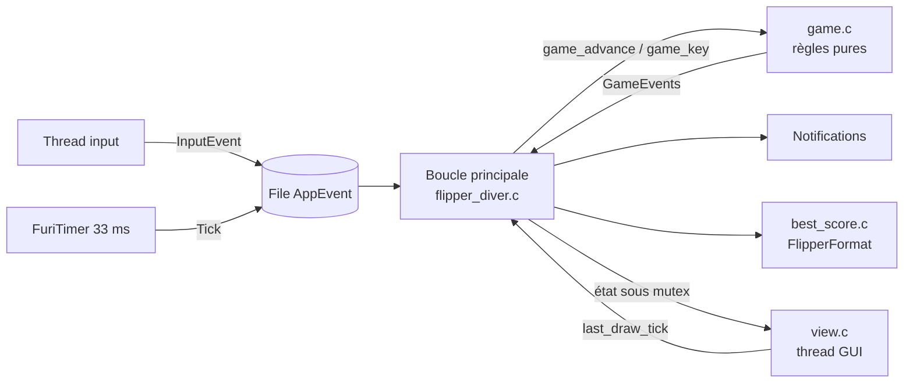
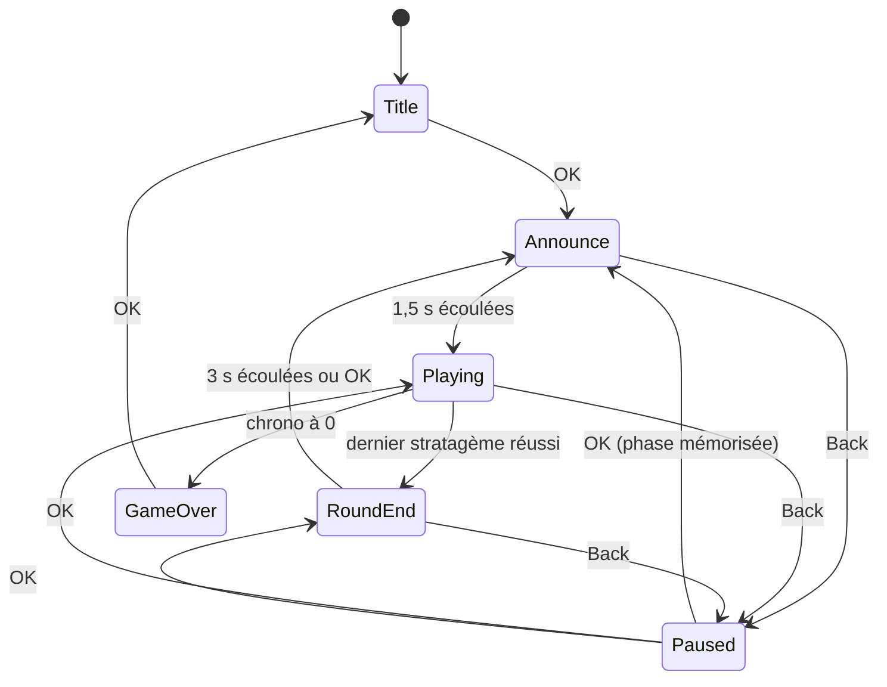

# 001 — Règles du jeu : design

## Vue d'ensemble

On garde l'architecture de la spec système : un seul `ViewPort` (ADR-0002), une
file d'événements, une boucle principale qui est seule à modifier l'état, et un
rendu qui le lit sous mutex. On ajoute :
- un **module de règles pur** (`game.c`), sans Furi, qui reçoit le temps écoulé
  et les touches et renvoie des événements de jeu. Toute la logique de
  REQ-001-3 à 11, 16-17 et 19 y est testée sur PC ;
- un **timer Furi** à 30 Hz qui pousse des ticks dans la file ;
- le **rendu** (`view.c`), les **icônes**, les **notifications** et le
  **stockage du record** (`best_score.c`) côté app.

## Changements

### Fichiers

| Fichier | Rôle | Dépend de Furi |
|---------|------|----------------|
| `game.h`, `game.c` | Machine à états et règles | non |
| `stratagems.h`, `stratagems.c` | Table constante : nom, séquence, longueur | non |
| `view.h`, `view.c` | Rendu de chaque phase, table des icônes | oui |
| `best_score.h`, `best_score.c` | Lecture et écriture du record | oui |
| `flipper_diver.c` | Point d'entrée, file, timer, notifications | oui |
| `images/*.png` | Icônes 16×16 des stratagèmes | — |
| `tests/test_game.c`, `tests/test.h` | Tests unitaires sur PC | non |

### Module de règles `game.c` (REQ-001-3 à 11, 16, 17, 19, 23, 25)

État `Game` alloué par l'appelant (dans la structure de l'app), sans allocation
interne (REQ-001-25). Phases :

Interface (détails dans `game.h` à l'implémentation) :
- `game_init(Game*, uint32_t seed, uint32_t best_score, uint32_t best_round)` —
  phase `Title`. Les manches et le record de manche sont des `uint32_t`.
- `game_advance(Game*, uint32_t elapsed_ms) -> GameEvents` — fait avancer le
  temps. Toutes les durées sont des **restes en ms** décrémentés ici (chrono,
  annonce, fin de manche, flash d'erreur) ; en pause, rien n'est décrémenté, et
  la reprise retrouve donc l'état exact (REQ-001-9, 17). Le temps restant quand
  une phase se termine est reporté sur la suivante (annonce → manche, fin de
  manche → annonce) : le résultat ne dépend pas du découpage des appels.
- `game_key(Game*, GameKey key) -> GameEvents` — `GameKey` vaut Up, Down,
  Left, Right, Ok ou Back. Le filtrage des types d'appui (Press pour les
  flèches, Short pour OK et Back) est fait par l'app (REQ-001-5).
- `game_pause(Game*)` — utilisé par l'app sur perte de l'écran (REQ-001-18).
- `GameEvents` est un champ de bits : `ArrowOk`, `Error`, `StratagemDone`,
  `RoundDone`, `GameOver`, `NewRecord`, `Quit`. L'app en déduit les
  notifications et l'éventuelle écriture du record.

Règles :
- Chrono : 10 000 ms au départ de chaque manche, +1 500 ms par stratagème
  réussi, plafonné à 10 000 (REQ-001-8).
- Ordre de traitement : l'app appelle toujours `game_advance` avec le temps
  écoulé **avant** `game_key`. Si le chrono atteint 0 dans `game_advance`, la
  partie passe en `GameOver` et la touche qui suit est traitée dans cette phase,
  donc ignorée pour la manche (REQ-001-10).
- Bonus (REQ-001-11) : calculés au passage en `RoundEnd`, après la recharge du
  dernier stratagème ; stockés dans `Game` pour que l'écran les affiche.
- Tirage (REQ-001-4) : générateur xorshift32 interne initialisé par `seed`.
  L'app fournit `furi_hal_random_get()`, les tests une valeur fixe. Un tirage
  qui retombe sur le stratagème précédent (y compris le dernier de la manche
  d'avant) est décalé au suivant dans la table, modulo sa taille. Le résultat
  est déterministe et sans boucle de rejet.
- La manche courante est un tableau fixe de 16 indices dans `Game`.
- `NewRecord` est émis au passage en `GameOver` si le score dépasse strictement
  le record ; `game.c` met alors à jour le record en mémoire et lève
  `Game.new_record`, remis à faux à la partie suivante, pour l'écran de game
  over (REQ-001-19).
- Le flash d'erreur ne s'écoule pas en pause, comme les autres durées.

### Table des stratagèmes `stratagems.c` (REQ-001-14, 15)

`static const` en flash : nom (`const char*`) et séquence en lettres `U`, `D`,
`L`, `R` (`const char*`, lisible pour la relecture) ; `stratagem_length` et
`stratagem_arrow` la décodent. Pas d'icône dans cette table, pour qu'elle reste
pure. `view.c` déclare un tableau `const Icon* const stratagem_icons[]` dans le
même ordre, et un `_Static_assert` sur les tailles fait échouer le build s'il
manque une icône (REQ-001-14). Il ne vérifie que le nombre : une permutation
des lignes passerait, d'où une entrée par ligne dans les deux tables et les
noms d'icônes calqués sur ceux des stratagèmes. Claude rédige la table ;
l'utilisateur valide les séquences.

### Rendu `view.c` (REQ-001-1, 12, 13, 16, 19)

Une fonction par phase, appelée par le callback de rendu sous mutex. Disposition
de l'écran de manche (en pixels, 128×64) :

| Zone | y | Contenu |
|------|---|---------|
| Rangée d'icônes | 0–19 | 5 emplacements de 16 px espacés de 24 px, centrés ; l'actif au centre (x = 56) encadré par un rectangle de 20×20 ; les réussis barrés d'une croix |
| Nom | 22–31 | `FontSecondary`, centré |
| Flèches | 34–45 | 8 flèches de 12 px au plus, pas de 14 px, centrées ; pleines si saisies, creuses sinon |
| Bas | 55–63 | jauge de 72×7 px (cadre) à gauche, « M3 1250 » aligné à droite (`FontSecondary`) ; il reste 55 px, soit 11 caractères environ |

- Les flèches sont dessinées avec des primitives (triangles et rectangles à
  partir de `canvas_draw_line` et `canvas_draw_box`), pas avec des icônes, pour
  avoir les versions pleine et creuse dans les 4 directions.
- Flash d'erreur (REQ-001-7) : pendant 120 ms après une erreur, un
  `canvas_draw_box` plein écran en `ColorXor` inverse l'image.
- L'écran de fin de manche révèle une ligne de bonus toutes les 500 ms, à partir
  du reste de temps de la phase.
- L'écran de pause ne lit que le score et la manche : il n'affiche ni nom, ni
  icône, ni flèche (REQ-001-16).
- Vérification du nom le plus long (REQ-001-13) : un test sur PC vérifie que
  chaque nom fait au plus 21 caractères, soit environ 126 px en
  `FontSecondary` (6 px par caractère en moyenne). La vérification réelle se
  fait sur l'appareil.

### Boucle principale `flipper_diver.c` (REQ-001-5, 9, 18, 22, 24)

- `AppEvent` = `{type: Input | Tick, InputEvent input}` dans une
  `FuriMessageQueue` de 16 éléments ; les callbacks d'entrée et de timer y
  écrivent avec un délai de 0.
- `FuriTimer` périodique de 33 ms (30 Hz, marge sur les 25 Hz de REQ-001-24).
  Chaque tick : `game_advance(furi_get_tick() - last_tick)`, puis
  `view_port_update`.
- Une entrée appelle d'abord `game_advance` du temps écoulé, puis `game_key` si
  le type d'appui est le bon, puis `view_port_update` tout de suite, sans
  attendre le tick suivant (latence REQ-001-24).
- Notifications (REQ-001-22), toutes via `notification_message` :
  - erreur : séquence propre à l'app, vibration de 100 ms et LED rouge
    (`message_vibro_on`, `message_red_255`, `message_delay_100`,
    `message_vibro_off`, `message_red_0`) ;
  - stratagème réussi : `sequence_blink_green_10` ;
  - fin de manche : `sequence_success` ;
  - game over : `sequence_error`.
- Perte de l'écran (REQ-001-18) : la GUI n'appelle le callback de rendu que pour
  le ViewPort visible (le dernier activé de la couche la plus haute, et en
  verrouillage seule la couche Desktop est dessinée). Le callback note
  `last_draw_tick`. À chaque tick, si la phase est `Announce`, `Playing` ou
  `RoundEnd` et qu'aucun rendu n'a eu lieu depuis plus de 250 ms, l'app appelle
  `game_pause`. **À vérifier sur l'appareil** : si la GUI appelle quand même le
  callback d'un ViewPort masqué, REQ-001-18 sera barrée avec l'accord de
  l'utilisateur. Le chrono tourne encore pendant la détection, ce qu'admet
  le critère de REQ-001-18 (à 250 ms près) : il n'avance qu'aux ticks où le
  dernier rendu date de 250 ms au plus, donc il perd au plus 250 ms depuis la
  perte de l'écran.
- Mesures (REQ-001-24, 25) : `FLIPPER_DIVER_METRICS` consigne le tas libre au
  début de la partie, puis à chaque fin de manche et au game over l'écart
  maximal entre deux images et la latence maximale entre un appui et son image.
- Pile du thread de l'app : 4 Kio, car il écrit le record (FlipperFormat).
- Sortie : sur `Quit`, libération dans l'ordre inverse de l'allocation (timer
  arrêté et libéré avant la file).

### Record `best_score.c` (REQ-001-1, 20, 21)

- `best_score_load(uint32_t* score, uint32_t* round) -> bool` : ouvre le
  stockage (`RECORD_STORAGE`) le temps de l'appel, puis
  `APP_DATA_PATH("best.fff")` (qui correspond à
  `/ext/apps_data/flipper_diver/best.fff`), vérifie l'en-tête
  `Filetype: Flipper Diver Best Score` et `Version: 1`, puis lit `Score` et
  `Round`. Tout échec renvoie `false` et un record de 0.
- `best_score_save(uint32_t score, uint32_t round) -> bool` :
  `flipper_format_file_open_always`, puis l'en-tête et les deux valeurs. Un échec
  est consigné avec `FURI_LOG_E` et n'interrompt pas le jeu.
- Appelée seulement quand `game_*` renvoie `NewRecord` (REQ-001-20).
- Les objets `FlipperFormat` sont alloués et libérés pendant l'appel, hors
  d'une manche : la seule allocation après l'initialisation a lieu sur l'écran de
  game over. Elle est hors du périmètre de REQ-001-25, qui vise la partie en
  cours.

### Manifeste `application.fam`

- `fap_icon_assets="images"` : génère `flipper_diver_icons.h` (REQ-001-14).
- `sources=["*.c", "!tests"]` : ufbt collecte les sources récursivement
  (`GatherSources` avec exclusions), et ceci exclut `tests/` du FAP
  (REQ-001-23). Pas de `*.c*` (valeur par défaut) : ce motif attrape aussi les
  caches Python `*.cpython-*.pyc` de `tools/`.

### Tests sur PC (REQ-001-23)

- `tests/test.h` : harnais minimal (macros `CHECK`, compte des échecs, code de
  sortie non nul).
- Compilation hors ufbt :
  `cc -std=gnu17 -Wall -Wextra -Werror -Wdouble-promotion -Wundef -fsanitize=address,undefined -I. game.c stratagems.c tests/test_game.c`.
  ufbt ne passe pas de `-std` (défaut de gcc 12, soit gnu17) et active les mêmes
  avertissements : le code accepté sur PC l'est aussi par ufbt. Script devenv
  `unit-tests`, appelé par `enterTest`.

## Erreurs et cas limites

| Cas | Comportement | REQ |
|-----|--------------|-----|
| Flèche pendant l'annonce, la fin de manche, la pause ou le game over | ignorée, pas d'erreur | 3, 16 |
| Chrono à 0 entre deux ticks, juste avant une saisie | `game_advance` passe en GameOver avant `game_key` | 10 |
| Retard du tick (GUI ou SD occupée) | `elapsed_ms` réel, rien n'est perdu | 9 |
| File d'événements pleine | événement abandonné (délai 0) ; le tick suivant rattrape le temps | 24 |
| Tirage égal au stratagème précédent | décalé au suivant dans la table | 4 |
| Fichier de record absent, illisible ou de mauvaise version | record 0, réécrit au prochain record | 21 |
| SD absente ou pleine à l'écriture | log d'erreur, le jeu continue | 21 |
| Score égal au record | pas de `NewRecord`, pas d'écriture | 19, 20 |
| Back en pause | `Quit` sans `NewRecord` ni écriture | 17 |
| Débordement du score | `uint32_t` : environ 1 000 points par manche, il faudrait des millions de manches | — |

## Alternatives écartées

- **Échéances absolues (`deadline = now + d`)** — la pause oblige à décaler
  toutes les échéances ; les restes décrémentés gèrent la pause gratuitement.
- **Dessiner depuis le thread du timer** — le rendu doit passer par la GUI ;
  le timer ne fait que pousser un événement.
- **Icônes de flèches en PNG** — 8 fichiers (4 directions, pleine et creuse) pour
  ce que quelques primitives dessinent.
- **Icône dans la table des stratagèmes** — rendrait `stratagems.c`
  dépendant de Furi et non testable sur PC ; un tableau parallèle et un
  `_Static_assert` garantissent la même chose.
- **`rand()` de la libc** — état global et résultat dépendant de la
  plateforme ; xorshift32 est déterministe partout.
- **Rejet et nouveau tirage en cas de doublon** — nombre de tirages non borné ;
  le décalage est borné et déterministe.

## Risques

- **Détection de perte d'écran** (REQ-001-18) : elle repose sur le fait que la
  GUI n'appelle pas le callback d'un ViewPort masqué. À vérifier tôt sur
  l'appareil ; sinon, barrer l'exigence.
- **Largeur réelle des noms** en `FontSecondary` : la police n'est pas à chasse
  fixe, et le test des 21 caractères est une approximation. Contrôle visuel sur
  l'appareil, et renommer au besoin (noms abrégés).
- **Mesure de REQ-001-24 et 25** sur l'appareil : instrumentation par logs
  derrière une constante de compilation, désactivée par défaut.
- **Charge graphique** : 20 icônes à dessiner (D8). Elles peuvent commencer
  comme des formes simples et être affinées sans toucher au code.

## Stratégie de test

| REQ | Vérification |
|-----|--------------|
| 2, 3, 4, 5 (côté règles), 6, 7, 8, 9, 10, 11, 16, 17, 19 (logique) | tests unitaires sur PC (`tests/test_game.c`) |
| 4 (10 000 manches sans doublon consécutif) | test de propriété sur PC, graine fixe |
| 14 | `_Static_assert` dans `view.c` (build) |
| 15, 13 (longueur des noms) | test sur PC qui parcourt la table |
| 23 | `devenv test` ; `arm-none-eabi-nm` sur le FAP ne trouve aucun symbole `test_` |
| 1, 12, 13, 16, 19 (affichage), 22 | manuel sur l'appareil avec `ufbt launch` |
| 18 | manuel : verrouillage ou ouverture d'une session qFlipper en pleine manche |
| 20, 21 | manuel : record battu puis relance ; fichier corrompu à la main ; sans carte SD |
| 24, 25 | manuel avec l'instrumentation par logs |

## ADR

- `docs/spec/adr/0004-regles-pures-testees-sur-pc.md` (accepted) : séparer les
  règles dans un module C sans Furi, testé sur PC sous sanitizers. C'est une
  décision qui survivra à cette fonctionnalité.
